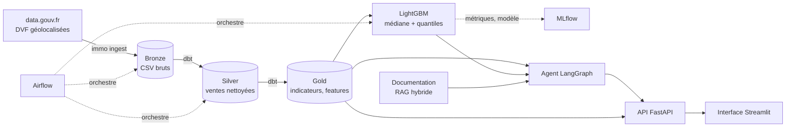
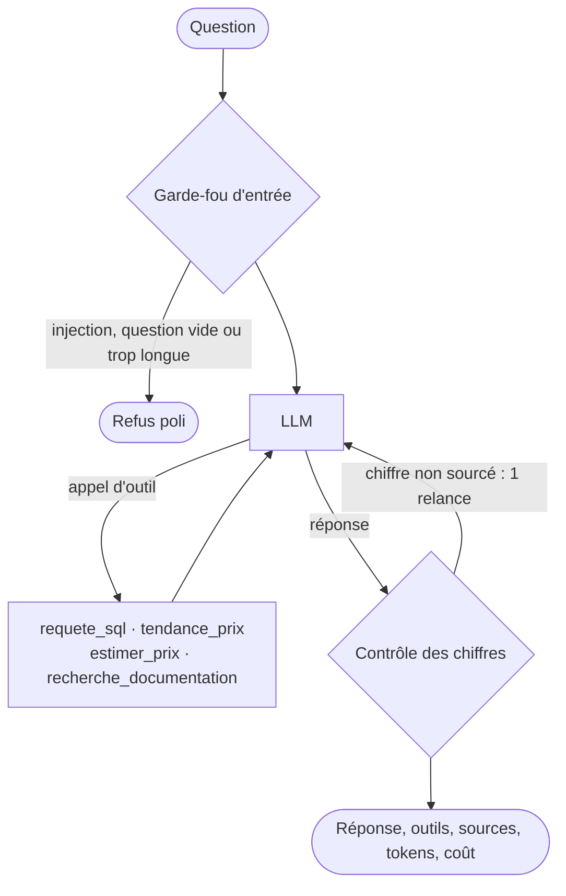

# Immo AI Platform

[](https://github.com/yaniil/immo-ai-platform/actions/workflows/ci.yml)


**Assistant IA sur le marché immobilier d'Île-de-France**, construit sur les données publiques DVF
(toutes les ventes immobilières déclarées en France). Le projet couvre toute la chaîne :

- un **lakehouse** DuckDB modélisé avec **dbt** (bronze → silver → gold), orchestré par **Airflow** ;
- un **modèle LightGBM** d'estimation de prix avec fourchette de confiance, suivi dans **MLflow** ;
- un **agent IA LangGraph** multi-outils (SQL, tendances, estimation, **RAG hybride**) avec garde-fous
  et **contrôle anti-hallucination des chiffres** ;
- une **évaluation par LLM-as-judge** avec suivi de la qualité, de la latence et du coût ;
- une **API FastAPI**, une interface **Streamlit**, **Docker Compose** et une **CI GitHub Actions**.

> Exemples : « Quel est le prix médian au m² à Clichy ? », « Quelles communes des Hauts-de-Seine sont les
> plus chères ? », « Combien vaut un 3 pièces de 60 m² à Versailles ? », « Pourquoi certaines ventes sont-elles
> exclues ? »

## Architecture



| Couche | Technologies |
|---|---|
| Ingestion et orchestration | Python, Requests, Apache Airflow 3 |
| Lakehouse | DuckDB, dbt (modèles, tests de données, documentation persistée) |
| Machine learning | LightGBM (régression + quantiles), MLflow (suivi, registre de modèles) |
| IA générative | LangGraph, LangChain, tool calling, RAG hybride (BM25 + embeddings fastembed), LLM-as-judge |
| LLM | Groq (gpt-oss-120b par défaut), Anthropic ou OpenAI, au choix |
| Produit | FastAPI, Pydantic, Streamlit, Plotly |
| Industrialisation | Docker, Docker Compose, GitHub Actions, pytest (68 tests), Ruff |

## Démarrage rapide

**Prérequis :** Python 3.11 ou plus, et une clé API gratuite [Groq](https://console.groq.com/keys) pour l'assistant.

```bash
git clone https://github.com/yaniil/immo-ai-platform.git
cd immo-ai-platform
python -m venv .venv
.venv\Scripts\activate            # Windows
# source .venv/bin/activate       # macOS / Linux
pip install -e ".[pipeline,llm,rag,app,dev]"

copy .env.example .env            # Windows (cp sous macOS / Linux), puis ajoutez GROQ_API_KEY

immo pipeline --source dvf        # téléchargement DVF + dbt + entraînement (quelques minutes)
immo serve                        # API sur http://localhost:8000/docs
streamlit run app/streamlit_app.py   # interface sur http://localhost:8501 (2e terminal)
```

Sans connexion internet, `immo pipeline --source sample` génère un **jeu synthétique** au format DVF
(signalé comme tel dans l'interface) : c'est celui qu'utilisent les tests et la CI.

Autres commandes : `immo ask "Prix à Clichy ?"`, `immo evaluate`, `mlflow ui --backend-store-uri sqlite:///data/mlflow.db`.

### Avec Docker

```bash
mkdir data models                                        # dossiers partagés avec les conteneurs
docker compose run --rm api immo pipeline --source dvf   # prépare les données
docker compose up --build                                # API :8000, interface :8501, MLflow :5000
docker compose --profile airflow up --build airflow      # Airflow :8080
```

## 1. Données et lakehouse

Les fichiers DVF géolocalisés (Etalab / DGFiP) des 8 départements franciliens sont téléchargés depuis
data.gouv.fr, puis transformés par dbt dans une base DuckDB organisée en trois couches :

- **bronze** : fichiers bruts, toutes colonnes en texte, avec traçabilité du fichier source ;
- **silver** : une ligne par vente d'un logement, typée et nettoyée ;
- **gold** : prix au m² par commune, département et mois, référentiel des communes, table d'entraînement.

Le nettoyage traite les pièges réels de DVF : une vente peut occuper plusieurs lignes, plusieurs
logements peuvent être vendus pour un prix global, un même local peut être répété sur plusieurs parcelles.
On ne garde que les mutations « Vente » (ni VEFA, ni échange...), avec **un seul logement** et sans local
d'activité, une surface de 9 à 1 000 m² et un prix au m² de 500 à 30 000 €.

`dbt build` exécute **16 tests de données** (unicité, valeurs acceptées, quartiles ordonnés, pas de vente
dans le futur, perte maximale de 70 % au nettoyage). Les descriptions des colonnes sont écrites dans DuckDB
(`persist_docs`) et servent directement à décrire le schéma à l'agent : une seule source de vérité.

Le DAG Airflow `immo_dvf_pipeline` enchaîne ingestion → `dbt build` → entraînement → évaluation de l'agent
(seulement si une clé LLM est configurée). Chaque tâche appelle la CLI : les mêmes étapes tournent à
l'identique en local, en CI et dans Airflow.

## 2. Modèle d'estimation

- **Cible** : log(prix au m²), pour que l'erreur soit relative.
- **Variables** : type de bien, surface, pièces, terrain, dépendances, commune, département, latitude,
  longitude, date.
- **Validation temporelle** : test sur les 6 derniers mois, jamais vus à l'entraînement (un découpage
  aléatoire serait trop optimiste).
- **Fourchette à 80 %** : deux modèles quantiles (10 % et 90 %), dont la couverture réelle est mesurée.
- **Référence** : le modèle est comparé à la médiane de la commune pour le même type de bien.
- **MLflow** : paramètres, métriques (MdAPE, MAE, R², couverture), importance des variables et modèle
  enregistré dans le registre `immo-prix-m2`.

Les métriques obtenues sur vos données sont affichées à la fin de `immo train`, dans l'interface et dans MLflow.

## 3. Agent IA



- **Outils** : SQL en lecture seule sur l'entrepôt, tendance d'une commune, estimation LightGBM et
  recherche dans la documentation (`docs/knowledge`).
- **SQL sécurisé, défense en profondeur** : validation du texte (une seule requête `SELECT`, aucune
  écriture ni lecture de fichier), connexion DuckDB en lecture seule **et** sans accès externe, résultats
  plafonnés et délai maximal.
- **RAG hybride** : BM25 pour les termes exacts (« VEFA », « Carrez ») et embeddings multilingues locaux
  (fastembed) pour les reformulations, fusionnés par Reciprocal Rank Fusion. Sans fastembed, repli sur BM25.
- **Anti-hallucination** : après chaque réponse, tous les nombres sont comparés aux résultats des outils
  (tolérance d'arrondi). Un chiffre non sourcé déclenche une relance de l'agent ; s'il persiste, il est signalé
  à l'utilisateur.
- **Suivi du coût** : tokens d'entrée et de sortie et coût estimé de chaque réponse.

## 4. Évaluation (LLM-as-judge)

`immo evaluate` pose 13 questions (chiffres, estimations, documentation, garde-fous) et fait noter chaque
réponse de 1 à 5 par un LLM juge. Les **réponses de référence sont recalculées sur les données chargées**
(requêtes SQL, appel direct au modèle) : le jeu de test reste valable après chaque mise à jour de DVF.
Le rapport (taux de réussite par catégorie, score moyen, latence, tokens, coût, usage des outils) est
enregistré en JSON et Markdown dans `data/eval/` et dans l'expérience MLflow `immo-agent-evaluation`.

## 5. API

| Méthode | Route | Rôle |
|---|---|---|
| GET | `/health` | état des données, du modèle et du LLM |
| GET | `/communes?recherche=cli` | recherche de communes |
| GET | `/communes/{commune}/tendance` | prix médian au m² par année |
| POST | `/estimation` | estimation d'un bien, avec fourchette et médiane communale |
| POST | `/assistant` | question à l'agent (avec historique de conversation) |

Documentation interactive : http://localhost:8000/docs

## Tests et CI

```bash
pytest -q        # 68 tests : nettoyage dbt, modèle, MLflow, SQL, garde-fous, RAG, agent, API, évaluation
ruff check .
```

Les tests construisent un entrepôt complet sur le jeu synthétique et testent l'agent avec un **LLM
scénarisé** (appels d'outils écrits à l'avance) : on vérifie le câblage du graphe, la boucle de
vérification des chiffres et le calcul du coût sans aucun appel réseau. La CI GitHub Actions lance le lint,
les tests et la construction de l'image Docker à chaque push.

## Structure

```
├── airflow/                DAG et image Airflow
├── app/                    interface Streamlit
├── dbt/                    modèles bronze / silver / gold, tests de données, macros
├── docs/knowledge/         documentation interrogée par le RAG
├── src/immo/
│   ├── ingestion/          téléchargement DVF, jeu synthétique
│   ├── transform.py        lancement de dbt
│   ├── ml/                 entraînement LightGBM + MLflow, prédiction
│   ├── agent/              graphe LangGraph, outils, garde-fous, RAG, SQL sécurisé
│   ├── evaluation/         LLM-as-judge et jeu de questions
│   ├── api/                API FastAPI
│   └── cli.py              commande `immo`
└── tests/
```

## Limites et pistes

- DVF ne renseigne ni l'étage, ni l'état, ni le DPE : l'estimation reste indicative.
- Les derniers mois publiés sont souvent incomplets (délais de publication des actes).
- Pistes : enrichir le modèle avec des données de quartier (IRIS, transports, DPE de l'ADEME), servir les
  embeddings depuis pgvector, ajouter un suivi de dérive du modèle entre deux publications DVF.

## Données

Demandes de valeurs foncières géolocalisées, DGFiP / Etalab, publiées sur data.gouv.fr. Les conditions
d'utilisation de DVF interdisent notamment toute réidentification des personnes concernées.
Code sous licence MIT.
